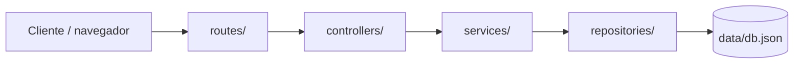
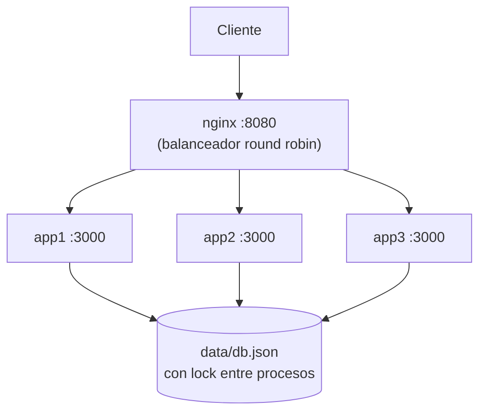

# ApuestAs

Aplicación educativa para predecir resultados del Mundial de fútbol y acumular puntos según la precisión de las predicciones. **Ejercicio académico, no involucra dinero real.**


---

## Índice

1. [Descripción](#descripción)
2. [Funcionalidades](#funcionalidades)
3. [Reglas de puntuación](#reglas-de-puntuación)
4. [Arquitectura](#arquitectura)
5. [Datos de demostración (seed)](#datos-de-demostración-seed)
6. [Ejecutar en local](#ejecutar-en-local-sin-docker)
7. [Ejecutar con Docker (escalamiento + balanceo de carga)](#ejecutar-con-docker-escalamiento-horizontal--balanceo-de-carga)
8. [Variables de entorno](#variables-de-entorno)
9. [Pruebas unitarias](#pruebas-unitarias)
10. [Pruebas de estrés](#pruebas-de-estrés)
11. [Estructura del proyecto](#estructura-del-proyecto)

---

## Descripción

Los usuarios se registran, predicen el marcador de los partidos del Mundial y suman puntos según qué tan acertada fue su predicción. Pueden competir en el ranking global o crear **salas privadas** para competir solo con sus amigos.

## Funcionalidades

| Módulo | Qué hace |
|---|---|
| **Autenticación** | Registro y login con JWT, contraseñas con hash + salt (`scrypt`) |
| **Partidos** | Crear partidos, registrar resultado final |
| **Predicciones** | Registrar/editar una predicción por partido antes de que empiece |
| **Puntuación** | Cálculo automático de puntos según las 5 reglas oficiales |
| **Ranking** | Tabla de posiciones global, ordenada por puntos |
| **Salas (grupos)** | Crear sala con código de invitación de 6 caracteres, unirse por código, ranking acotado a los miembros de la sala |
| **Calendario** | Fixture del Mundial Qatar 2022 con alineaciones mostradas en una **cancha visual** por posición |

## Reglas de puntuación

| Regla | Puntos | Ejemplo |
|---|---|---|
| Resultado exacto | **5** | Predice 2-1, termina 2-1 |
| Ganador correcto (o empate) | **3** | Predice 3-1, termina 2-1 (ambos gana el local) |
| Diferencia de goles correcta | **2** | Predice 0-2, termina 2-0 (margen de 2 en ambos, distinto ganador) |
| Bonus por racha | **+2** | Cada 3 partidos consecutivos acertando *al menos el ganador* |
| Predicción anticipada | **+1** | Registrada con más de 24h de anticipación al partido |

Implementado en [`src/services/scoring.service.js`](src/services/scoring.service.js) y verificado con pruebas unitarias en [`test/scoring.service.test.js`](test/scoring.service.test.js).

## Arquitectura

MVC + repositorios + servicios, con persistencia en un JSON (`data/db.json`) protegido por un lock de archivo para soportar múltiples réplicas escribiendo a la vez:



- **routes/** define los endpoints HTTP y aplica middlewares (auth).
- **controllers/** traducen request/response, sin lógica de negocio.
- **services/** contienen las reglas de negocio (puntuación, validaciones, salas).
- **repositories/** son la única capa que toca el almacenamiento (`json.repository.js` centraliza lectura/escritura y el lock entre procesos).

## Datos de demostración (seed)

```bash
npm run seed
```

Usa **exclusivamente los partidos del calendario** (mismos equipos, banderas y formación que [Calendario](#funcionalidades) — nada inventado) y deja la app lista para usar/evaluar, no vacía:

- **1 partido genuinamente abierto** (Estados Unidos vs Gales, el mismo del calendario) sin resultado ni predicciones precargadas, para que cualquier usuario vote su propia predicción desde "Partidos disponibles" — con sus banderas y formación, igual que en el calendario.
- **3 partidos del calendario ya finalizados** (Qatar-Ecuador, Inglaterra-Irán, Senegal-Países Bajos) con los resultados reales del Mundial Qatar 2022, usados solo para demostrar la puntuación.
- **4 usuarios de demostración** (contraseña `Demo1234`) cuyas predicciones sobre esos 3 partidos ejercitan, a propósito, cada una de las 5 reglas de puntuación — resultado exacto, ganador correcto, diferencia de goles, bono de racha (3 aciertos seguidos) y bono/no-bono por anticipación:

| Usuario | Correo | Puntos esperados | Qué demuestra |
|---|---|---|---|
| Camila Rojas | camila.rojas@apuestas.demo | 19 | Acierta todo exacto + bono de racha |
| Diego Castillo | diego.castillo@apuestas.demo | 13 | Acierta solo el ganador + bono de racha |
| Valeria Núñez | valeria.nunez@apuestas.demo | 8 | Acierta solo la diferencia de goles (sin racha) |
| Renzo Flores | renzo.flores@apuestas.demo | 2 | Falla casi todo, incluida una predicción no enviada |

El script es idempotente: si ya existe "Camila Rojas" no vuelve a sembrar. Ver [`scripts/seed-demo.js`](scripts/seed-demo.js).

## Ejecutar en local (sin Docker)

```bash
npm install
npm run dev
```

La app queda en `http://localhost:3000/apuestas`.

## Ejecutar con Docker (escalamiento horizontal + balanceo de carga)

El `docker-compose.yml` levanta 3 réplicas de la app detrás de un balanceador **nginx** (round robin):



```bash
docker compose up -d --build
```

La app queda disponible en `http://localhost:8080/apuestas` (puerto configurable con `LB_PORT`). Las réplicas no publican puerto propio: solo nginx es accesible desde el host. Los datos se persisten en `./data/db.json` mediante un volumen compartido, con un lock de archivo (`src/repositories/json.repository.js`) que serializa las escrituras concurrentes entre procesos para que no se pierdan registros bajo carga.

Cada respuesta incluye el header `X-Instance-Id` (y `/health` el campo `instance`) para comprobar qué réplica atendió la petición:

```bash
for i in $(seq 1 6); do curl -s http://localhost:8080/health; echo; done
```

Para detener:

```bash
docker compose down
```

### Escalar a más réplicas

Duplicar un bloque `appN` en `docker-compose.yml` con su propio `INSTANCE_ID`, agregarlo al `upstream apuestas_backend` en `nginx/nginx.conf`, y reiniciar con `docker compose up -d --build`.

## Variables de entorno

Ver [`.env.example`](.env.example).

| Variable | Descripción | Default |
|---|---|---|
| `PORT` | Puerto HTTP de la app (o del balanceador, con `LB_PORT`) | `3000` |
| `NODE_ENV` | Entorno (`development` / `production`) | `development` |
| `JWT_SECRET` | Secreto para firmar los tokens de sesión | *(definir uno propio)* |
| `INSTANCE_ID` | Identificador de réplica (lo asigna `docker-compose.yml`, no es necesario setearlo a mano) | `local` |

## Pruebas unitarias

```bash
npm test
```

Corre con el test runner nativo de Node (`node --test`, sin dependencias extra) y cubre las 5 reglas de puntuación y el hash/verificación de contraseñas. Ver [`test/`](test/).

## Pruebas de estrés

```bash
npm run stress:read   # GET /health, /calendar, /matches, /apuestas
npm run stress:write  # registro + partido + prediccion encadenados (ejercita el lock)
```

Requieren el stack levantado (`docker compose up -d --build`) y usan `http://localhost:8080` por defecto (configurable con `TARGET`, `CONNECTIONS`, `DURATION`). Metodología, resultados y un bug de concurrencia real que se encontró y corrigió durante estas pruebas: [`docs/pruebas-estres.md`](docs/pruebas-estres.md).

## Estructura del proyecto

```
SEMANA12/
├── src/
│   ├── app.js                 # configuracion de Express
│   ├── server.js               # arranque del servidor
│   ├── config/env.js           # variables de entorno
│   ├── controllers/            # auth, match, prediction, ranking, room, calendar, health
│   ├── services/                # reglas de negocio (incluye scoring.service.js)
│   ├── repositories/            # acceso a data/db.json + lock entre procesos
│   ├── middlewares/             # auth JWT, manejo de errores
│   ├── routes/                   # un router por recurso
│   └── data/world-cup-calendar.js # fixture + planteles Qatar 2022
├── public/                       # frontend (HTML/CSS/JS sin framework)
├── test/                         # pruebas unitarias (node --test)
├── stress/                       # scripts de pruebas de carga (autocannon)
├── scripts/seed-demo.js          # datos de demostracion (partidos + usuarios)
├── docs/pruebas-estres.md        # metodologia y resultados de las pruebas de estres
├── nginx/nginx.conf              # balanceador de carga
├── Dockerfile / docker-compose.yml
└── data/db.json                  # "base de datos" (JSON, gitignored)
```
